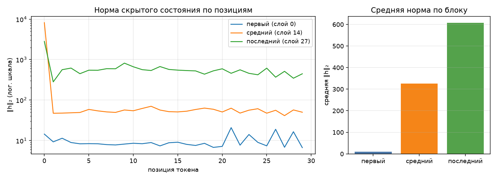

# Анатомия Qwen3-0.6B

Сгенерировано `make inspect`. dtype `bfloat16`, device `mps`.

## 1. Конфигурация

| Параметр | Значение |
|---|--:|
| слоёв | 28 |
| hidden_size | 1024 |
| intermediate_size | 3072 |
| голов запроса | 16 |
| KV-голов (GQA) | 8 |
| head_dim | 128 |
| словарь | 151 936 |
| tie_word_embeddings | True |

GQA: 16 голов запроса на 8 KV-головы — KV-cache вдвое меньше, чем при обычном multi-head.

## 2. Условия замера

| Условие | Значение |
|---|---|
| платформа | macOS-26.3.1-arm64-arm-64bit-Mach-O (Darwin 25.3.0, arm64) |
| устройство | `mps` |
| dtype | `bfloat16` |
| seq_len × batch | 256 × 1 |
| прогонов на режим | 1 |
| память измерена | `torch.mps.driver_allocated_memory` |
| RSS измерена | `ru_maxrss` |
| python | 3.14.3 |
| torch | 2.14.0 |
| transformers | 5.17.0 |
| peft | 0.20.0 |

Цифры ниже верны только для этих условий. Замер памяти без указания
устройства, dtype, длины последовательности и метрики не воспроизводится
и не сравнивается — поэтому источник метрики стоит отдельной строкой.
Сверьте, что в этой строке названа метрика, уместная для вашего
устройства, и что полученные числа с ней согласуются.

## 3. Параметры по типам модулей

| Группа | Модулей | Shape | Параметров | Доля | Разделяет тензор |
|---|--:|---|--:|--:|--:|
| `embed` | 1 | 151936×1024 | 155 582 464 | 26.10% | — |
| `q_proj` | 28 | 2048×1024 | 58 720 256 | 9.85% | — |
| `k_proj` | 28 | 1024×1024 | 29 360 128 | 4.93% | — |
| `v_proj` | 28 | 1024×1024 | 29 360 128 | 4.93% | — |
| `o_proj` | 28 | 1024×2048 | 58 720 256 | 9.85% | — |
| `gate_proj` | 28 | 3072×1024 | 88 080 384 | 14.78% | — |
| `up_proj` | 28 | 3072×1024 | 88 080 384 | 14.78% | — |
| `down_proj` | 28 | 1024×3072 | 88 080 384 | 14.78% | — |
| `norm` | 113 | 128, 1024 | 65 536 | 0.01% | — |
| `lm_head` | 1 | 151936×1024 | 0 | 0.00% | 155 582 464 |
| **итого** | | | **596 049 920** | 100% | |

Контроль: `sum(p.numel() for p in model.parameters())` = 596 049 920 — сходится с суммой по таблице.

Обратите внимание на строку `lm_head` и на значение `tie_word_embeddings`
в конфигурации: они связаны, и от этой связи зависит итог таблицы.

## 4. Нормы активаций (forward-hooks)

Промпт: «Объясни, что такое MLOps, в трёх предложениях.», 30 токенов после chat template.

| Блок | Индекс | Средняя ‖h‖₂ | Максимум |
|---|--:|--:|--:|
| первый | 0 | 9.7 | 20.9 |
| средний | 14 | 325.5 | 8189.7 |
| последний | 27 | 606.9 | 2815.1 |

Норма растёт от блока к блоку — прямое следствие residual-связей: блок
добавляет к потоку, а не заменяет его. Максимум на порядок-два выше среднего,
и сидит он на первой позиции: это attention sink, массивная активация,
в которую модель складывает «внимание ни к чему». Поэтому шкала на графике
логарифмическая — в линейной один этот выброс придавил бы всё остальное.

Прогон с хуками должен быть повторяемым: второй вызов в том же процессе
обязан дать те же числа и не оставить следов на модулях.

## 5. Сколько параметров добавляет LoRA

| Конфиг | Целевых модулей | Своя формула | peft | Совпало | % от базовой |
|---|--:|--:|--:|:-:|--:|
| r=8, q_proj+v_proj | 2 типов | 1 146 880 | 1 146 880 | да | 0.192% |
| r=16, все линейные | 7 типов | 10 092 544 | 10 092 544 | да | 1.693% |

Формула: `r * (in_features + out_features)` на каждый целевой `Linear` —
`A` формы `(r, in)`, `B` формы `(out, r)`, смещений нет. Расхождение с
`print_trainable_parameters()` означает ошибку в списке целевых модулей,
а не «разные способы считать».

Доля в таблице считается от базовой модели. `peft` печатает свою долю от
модели ВМЕСТЕ с адаптером, поэтому его процент чуть меньше — числитель
у обоих один и тот же.

## 6. Память в трёх режимах

Один шаг на seq_len=256, batch=1, device=mps. Метрика — аллокатор mps (`torch.mps.driver_allocated_memory`), пик за прогон; колонка «Пик RSS» снята через `ru_maxrss`.
Вход — случайные id токенов: меряется память, а не качество, и loss здесь
смысловой нагрузки не несёт (у full FT и LoRA он одинаковый, потому что
`B` в адаптере инициализирован нулями и до первого шага ничего не меняет).
Числа должны отличаться: по лекции full fine-tune стоит кратно дороже
инференса, а LoRA лежит между ними.

| Режим | Пик, МБ | Пик RSS, МБ | × к инференсу | Секунд | loss |
|---|--:|--:|--:|--:|--:|
| инференс | 2222 | 2065 | 1.00 | 4.4 | — |
| full fine-tune | 6748 | 2066 | 3.04 | 6.3 | 14.0827 |
| LoRA (r=8, q/v) | 3604 | 2065 | 1.62 | 3.7 | 14.0827 |

Прикидка из лекции: веса bf16 — 1137 МБ. Full fine-tune добавляет
градиенты (+1137 МБ) и два состояния AdamW (+2274 МБ),
то есть ×4 к весам ещё до активаций — что и видно в замере.
LoRA обучает 1 146 880 параметров вместо 596 049 920:
градиенты и состояния оптимизатора считаются только для адаптера, базовые
веса заморожены. Остаётся расход на активации — поэтому LoRA всё же дороже
инференса, хоть и втрое дешевле полного дообучения.

Колонка «Пик RSS» между режимами почти не меняется: разброс 1 МБ на все три — и это при том, что full fine-tune обязан добавить к весам ещё 3411 МБ.
Объясните этот разброс: что именно меряет `ru_maxrss` на устройстве `mps` и где на самом деле лежат тензоры.

## 7. Разбор четырёх заложенных дефектов

### Дефект 1 — хуки навешивались, но не снимались

**В чём был.** `forward_hooks()` вызывала `module.register_forward_hook(...)`,
но возвращаемые handles выбрасывала — снять хуки было нечем, и
`activation_norms()` их и не снимала.

**Как проявлялся.** Каждый вызов `activation_norms()` навешивал новый комплект
из 3 хуков: после первого прогона `sum(len(m._forward_hooks) for m in
model.modules())` = 3, после второго = 6. Модель оставалась «грязной» после
прогона, повторный замер считал активации по нескольку раз, память росла.

**Как исправлен.** `forward_hooks()` возвращает `(store, handles)`;
`activation_norms()` снимает хуки в `try/finally` через `handle.remove()` —
даже если forward упадёт с исключением, хуков на модулях не останется.

**Чем подтверждается.** Проверка 3 в `check.sh`: два прогона подряд в одном
процессе, «после двух прогонов зарегистрированных хуков: 0».

### Дефект 2 — tied embeddings посчитаны дважды

**В чём был.** `parameter_rows()` обходила `named_parameters(remove_duplicate=False)`
и жёстко ставила `tied: False` каждой строке. У Qwen3-0.6B
`tie_word_embeddings = True`: `lm_head.weight` и `embed_tokens.weight` — один
и тот же тензор (151936×1024 = 155 582 464 параметров), и он попадал в сумму
дважды.

**Как проявлялся.** Итог по таблице — 751 632 384 вместо 596 049 920
(+155 582 464, ~+26%, «модель 0.75B»), расхождение с
`sum(p.numel() for p in model.parameters())`.

**Как исправлен.** В `parameter_rows()` ведётся множество `seen` из `id(param)`;
повторное вхождение тензора помечается `tied=True`, и `group_table()` кладёт его
в колонку «Разделяет тензор», а не в сумму параметров.

**Чем подтверждается.** Проверка 1: по таблице 596 049 920 = напрямую
596 049 920, строка `lm_head` в таблице — 0 собственных параметров и
155 582 464 разделяемых.

### Дефект 3 — память снималась один раз в конце, после сборки мусора

**В чём был.** `PeakMemory.__exit__` сначала делал `gc.collect()`, потом снимал
одно текущее значение занятой памяти. Это не пик (high-water mark), а остаток
после уборки: градиенты и активации к этому моменту уже освобождены. Вдобавок
`memory_profile()` гоняла все режимы в одном процессе, хотя пиковые метрики
за жизнь процесса не сбрасываются.

**Как проявлялся.** Три режима давали почти одинаковые «подозрительно ровные»
числа: после шага оптимизатора остаток у full fine-tune почти тот же, что у
инференса, и проверка `full_ft > lora > inference` падала.

**Как исправлен.** `PeakMemory` теперь меряет пик за прогон: на cuda —
`reset_peak_memory_stats()` на входе и `max_memory_allocated()` на выходе;
на mps, где пиковой статистики у аллокатора нет, фоновый поток раз в 10 мс
опрашивает `driver_allocated_memory()` и запоминает максимум; `gc.collect()`
перед замером убран. `memory_profile()` запускает каждый прогон отдельным
процессом `python -m src.inspect_model --probe <mode>`.

**Чем подтверждается.** Проверка 4: inference 2222 МБ < LoRA 3604 МБ <
full FT 6748 МБ — против лекционных 2222 / 3606 / 7166 МБ на том же устройстве.

### Дефект 4 — на ускорителе память мерялась через RSS процесса

**В чём был.** `device_allocated_bytes()` и `device_metric_source()` на любом
устройстве ходили в `peak_rss()` (`ru_maxrss`). На mps тензоры лежат в буферах
Metal и в RSS процесса попадают лишь частично; в отчёте при этом была названа
«метрика аллокатора», а числа вели себя как RSS.

**Как проявлялся.** Три режима почти не различались по «памяти», числа слабо
реагировали на смену модели в `params.yaml`; на модели покрупнее «память
модели» выходила меньше веса её собственных параметров (веса Qwen3-0.6B в
bf16 — 1137 МБ, а RSS показывал бы меньше).

**Как исправлен.** Метрика выбирается по устройству: mps —
`torch.mps.driver_allocated_memory()`, cuda — `torch.cuda.max_memory_allocated()`,
cpu — `ru_maxrss` / `peak_wset`. RSS остался отдельной справочной колонкой.

**Чем подтверждается.** Колонка «Пик RSS» в таблице памяти: 2065 / 2066 / 2065 МБ —
разброс меньше 1 МБ на все три режима, тогда как аллокатор mps показывает
разницу в 4526 МБ между инференсом и full fine-tune. Все пики аллокатора
больше 1137 МБ весов модели.
