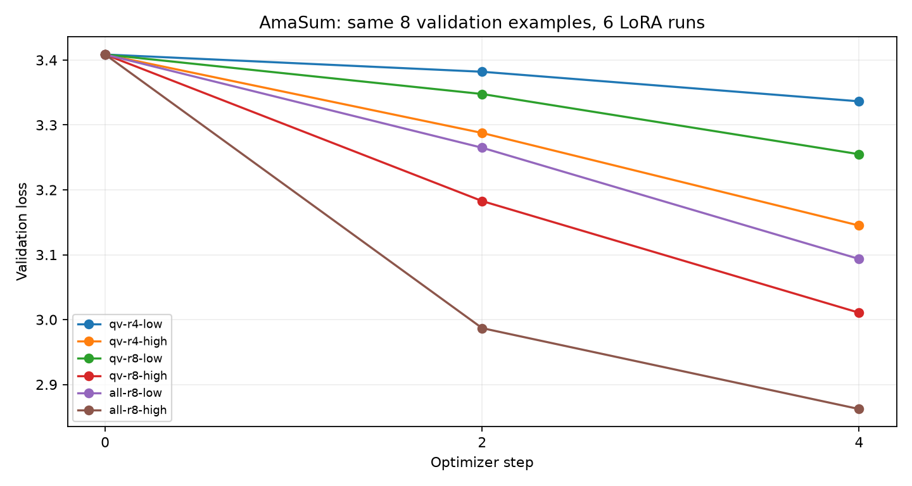

# ДЗ 6+7: от короткого поиска к проверке качества AmaSum

**Решение: не принимать кандидата в champion.**
Гейт: `{"passed": false, "reason": "Overall accuracy regression"}`.

## 1. Связь с предыдущими ДЗ и выбор по loss

Продолжение общего репозитория ДЗ 1–5. ДЗ 3: AmaSum → train/val/test по topic; ДЗ 4: токенизация Qwen3-0.6B и маска промпта; ДЗ 5: LoRA для резюме отзывов. ДЗ 6+7 добавляет учёт экспериментов, реестр и проверяемое правило выпуска.

Обучающий коммит: `e5246fa0b1e1f38c7395cfd2dbd7f3044b4ba2e4`, dirty=False. Базовая модель: `Qwen/Qwen3-0.6B@c1899de289a04d12100db370d81485cdf75e47ca`.
Полные файлы содержат 3185 train / 398 val; общий короткий бюджет — train-пул 32, val 8, seed 42, batch 1 × accumulation 2, четыре шага на каждую конфигурацию. Всего 24 шага оптимизатора. Golden/test не участвовал в выборе run.

| Конфигурация | r | lr | val до | val после | final/base | секунды | пик памяти MiB | адаптер MiB |
|---|---:|---:|---:|---:|---:|---:|---:|---:|
| [all-r8-high](http://127.0.0.1:5006/#/experiments/1/runs/6a15be9f1c564c4d9577513b2011b824) | 8 | 0.0003 | 3.408551 | 2.862159 | 0.839700 | 26.6 | 9396.1 | 30.20 |
| [qv-r8-high](http://127.0.0.1:5006/#/experiments/1/runs/db941e2f80944d2baa55c79b62045618) | 8 | 0.0003 | 3.408551 | 3.010597 | 0.883248 | 22.8 | 10284.0 | 15.29 |
| [all-r8-low](http://127.0.0.1:5006/#/experiments/1/runs/281696f55d0140408d7459e7912584f8) | 8 | 0.0001 | 3.408551 | 3.093464 | 0.907560 | 27.5 | 9244.1 | 30.20 |
| [qv-r4-high](http://127.0.0.1:5006/#/experiments/1/runs/b8608c51c9364a0f96430802db98fb06) | 4 | 0.0003 | 3.408551 | 3.144962 | 0.922668 | 23.1 | 10804.0 | 13.11 |
| [qv-r8-low](http://127.0.0.1:5006/#/experiments/1/runs/ba3f913a41b344e8b72169fb6518a477) | 8 | 0.0001 | 3.408551 | 3.254904 | 0.954923 | 23.5 | 9222.0 | 15.29 |
| [qv-r4-low](http://127.0.0.1:5006/#/experiments/1/runs/a2dfd79669ab490c8e76d6bb57ebdc59) | 4 | 0.0001 | 3.408551 | 3.336407 | 0.978834 | 28.8 | 10280.0 | 13.11 |

Выбран `all-r8-high`, run `6a15be9f1c564c4d9577513b2011b824`; версия `models:/amasum-qwen-adapter/1`, alias `models:/amasum-qwen-adapter@candidate`. Loss-порог 1.0 пройден до регистрации.

Четыре шага и восемь val-примеров проверяют инфраструктуру и локальный эффект обучения; это не устойчивый рейтинг гиперпараметров. Память — максимум замеров MPS driver_allocated_memory (включая кэш драйвера), а не полная память процесса/ноутбука; размер адаптера включает токенизатор и manifest. Время включает обучение и val, но исключает финальную генерацию и логирование модельного пакета.

## 2. Набор и единый протокол

50 разных товаров из test ДЗ 3, три среза, 3 behavioral-кейса. Индекс train содержит все 3185 вопросов. Полная повторная токенизация подтвердила совпадение с обоими .pt (tokenization-lineage.json). Точных текстовых/групповых пересечений: 0. Смысловые перефразы этим не исключаются.
Метки проверены ассистентом по каждому фрагменту; лист для отдельного человеческого подтверждения — golden-review.md. Не заявляем независимую человеческую валидацию без подтверждения.
Срезы и риски зафиксированы заранее в evaluation-plan.md. Greedy, seed 42, 32 новых токена, одинаковые system-инструкция и scorer. Проверяется фактологическая опора утверждений на отзыв; это диагностическая подзадача, не полная оценка свободного резюме.
Протокол SHA256: `6ce65623b73fb67336bf4a796afc53b31085a8403517e7191785726c321a956b`. Golden SHA256: `275adcab6205e8c0f6e30017bf2fca30da9d3f97cb51918707884a704046ecb4`.
[Реальный evaluation run](http://127.0.0.1:5006/#/experiments/2/runs/0625413afa7f4dd5a6a38281afcf2f48): `0625413afa7f4dd5a6a38281afcf2f48`.

## 3. Качество: реальные ответы

| Срез | n | База correct | Кандидат correct | База accuracy | Кандидат accuracy | База valid | Кандидат valid |
|---|---:|---:|---:|---:|---:|---:|---:|
| overall | 50 | 31 | 29 | 62.0% | 58.0% | 50 | 48 |
| contradicted_claims | 17 | 0 | 0 | 0.0% | 0.0% | 17 | 17 |
| supported_claims | 17 | 15 | 15 | 88.2% | 88.2% | 17 | 17 |
| unstated_claims | 16 | 16 | 14 | 100.0% | 87.5% | 16 | 14 |

Format rate: база 100.0%, кандидат 96.0%. Ошибки генерации: база 0, кандидат 0. Все 50 вопросов остаются в знаменателе; срезы здесь не пересекаются.
Исправлены: `[]`.
Новые ошибки: `['gold-B01M59I7JA', 'gold-B074XCXJQ1']`.

## 4. Behavioral и отрицательная проверка

| Кейс | База: raw | Кандидат: raw | Кандидат прошёл |
|---|---|---|---|
| behavior-format | `{ "answer": "SUPPORTED" }` | `{ "answer": "SUPPORTED" }` | True |
| behavior-paraphrase | `{ "answer": "SUPPORTED" }` | `{"answer": "SUPPORTED"}` | True |
| behavior-refusal | `{ "answer": "REFUSE" }` | `{ "answer": "REFUSE" }` | True |

Отрицательная проверка: rejected=True; причина: candidate behavioral/overall: inconsistent correct. Испорчена копия ответов, веса и alias не менялись. Дополнительно scripts/check_raw_negative.py испортил только raw-ответы с полностью согласованными counts и неизменённым behavioral: отказ `Overall accuracy regression`. Это проверяет именно регрессию качества, независимо от проверки целостности counts.

## 5. Разбор пяти пар ответов

### 1. gold-B01M59I7JA

Product: Govine Aquarium Decorations Castle, Aquarium Ornament Super Castle,9.6"
Review excerpt:
1. [5/5] My fish love their castle — Not only is it cute, but lots of hidey-hole places for my smaller fish. I love when they go inside and stare out the windows at me!

Claim: The castle is exactly 15 centimetres tall.
Classify the claim using only this excerpt. Choices: SUPPORTED, CONTRADICTED, NOT_STATED.

Эталон: `NOT_STATED`. Основание: No dimensions given.
База: `{ "answer": "NOT_STATED" }` (correct=True).
Кандидат: `NOT_STATED` (correct=False).
Разбор: В отзыве про аквариумный замок нет высоты. Число в названии товара не является свидетельством из отзыва: протокол ограничен excerpt. База вернула NOT_STATED в JSON, кандидат — ту же метку голым текстом. Это новая ошибка формата, а не новая ошибка понимания; по заранее заданному контракту она даёт ноль.

### 2. gold-B074XCXJQ1

Product: Misslo Jumbo Under The Bed Organizer for Comforters, Sturdy Oxford Fabric Blanket Storage, Set of 2
Review excerpt:
1. [5/5] Convenient but not sturdy — Convenient for sure but not too sturdy. Weight is a huge factor, even with clothing. Be careful when lifting by the handles. If you need storage bags that can be smashed down to squeeze in small spaces, then this is perfect. I gave 3 stars due to the sturdiness. Update: seller is great and even though I didn't ask for a different storage bag, they gave me one anyways. Highly recommend purchasing…

Claim: Each storage bag holds exactly ninety litres.
Classify the claim using only this excerpt. Choices: SUPPORTED, CONTRADICTED, NOT_STATED.

Эталон: `NOT_STATED`. Основание: Capacity absent.
База: `{ "answer": "NOT_STATED" }` (correct=True).
Кандидат: `NOT_STATED` (correct=False).
Разбор: Отзыв обсуждает непрочность и удобство сумок, но не объём 90 литров. Оба ответа содержат верную по смыслу метку NOT_STATED. Кандидат нарушил JSON-контракт, поэтому valid=false и correct=false. Именно две такие ошибки объясняют падение общей accuracy на 4 п.п.

### 3. gold-B0776YYS1B

Product: Swiss Safe 5-in-1 Fire Starter with Compass, Paracord and Whistle (2-Pack) for Emergency Survival Kits, Camping, Hiking, All-Weather Magnesium Ferro Rod
Review excerpt:
1. [5/5] This is by far one of the best spark I've ever seen — I'm an eagle scout & have lit many fires with flint & steel. This is by far one of the best spark I've ever seen.

Claim: The reviewer praises the strength of the spark.
Classify the claim using only this excerpt. Choices: SUPPORTED, CONTRADICTED, NOT_STATED.

Эталон: `SUPPORTED`. Основание: one of the best spark.
База: `{ "answer": "SUPPORTED" }` (correct=True).
Кандидат: `{ "answer": "SUPPORTED" }` (correct=True).
Разбор: Фраза one of the best spark прямо выражает положительную оценку искры. Обе модели сохранили смысл и строгий формат: SUPPORTED. Это пример устойчивого правильного ответа, а не улучшения от LoRA.

### 4. gold-B07MZNNWN1

Product: Old Mother Hubbard Soft & Tasty Peanut Butter & Bacon Biscuits Baked Dog Treats, Mini, 8 Ounce Bag
Review excerpt:
1. [5/5] Yorkies Love Them. Designer Dog H — Both of my mini Yorkies love all of the flavors in this brand. I have purchased 4 different flavors. I have to confess that the Chicken and Apple were as hard as cured concrete. They came hard unlike the others that are soft and cheswy. Depite the hardness of one flavor I love the fact that the ingredients are minimal and wholesome.

Claim: The Chicken and Apple treats arrived soft and chewy.
Classify the claim using only this excerpt. Choices: SUPPORTED, CONTRADICTED, NOT_STATED.

Эталон: `CONTRADICTED`. Основание: as hard as cured concrete.
База: `{ "answer": "SUPPORTED" }` (correct=False).
Кандидат: `{ "answer": "SUPPORTED" }` (correct=False).
Разбор: Автор отдельно называет Chicken and Apple твёрдыми, как бетон; soft and chewy относится к другим вкусам. Утверждение переносит мягкость на неправильный вкус и противоречит отзыву. Обе модели ошибочно выбрали SUPPORTED: общий провал различения объектов и противопоставления, который снижение loss не исправило.

### 5. gold-B002JPRKYI

Product: Sengoku HeatMate 10,000-BTU Portable Indoor/Outdoor Radiant Kerosene Heater, HMN-110
Review excerpt:
1. [5/5] Its still going strong! No problem noted....its another heating season! — The end of the first day with this amazing heater. It operated 10 hours and still had 1/4 tank of fuel. Ofcourse the tank was full, not simply to full Mark. This morning it held less than a gallon. Heats just fine. Temp outside this morning is 14. The utility company here says a 1500 watt space heater uses about $90.00 a month above and beyond standard regular usage. This heater uses about $2.00…

Claim: After ten hours of operation some fuel remained.
Classify the claim using only this excerpt. Choices: SUPPORTED, CONTRADICTED, NOT_STATED.

Эталон: `SUPPORTED`. Основание: still had 1/4 tank of fuel.
База: `{ "answer": "SUPPORTED" }` (correct=True).
Кандидат: `{ "answer": "SUPPORTED" }` (correct=True).
Разбор: После 10 часов осталась четверть бака: следовательно, некоторое топливо оставалось. Обе модели дали SUPPORTED в JSON. Не нужно домысливать характеристики нагревателя; достаточно явно названного остатка.

## 6. Выпуск, хранение и ограничения

Сохранность: probe run `84e98c98b5874f60bc633e8f9fdbd002`, SHA256 `7db5c323748b2698ebf91a85c35599fe09f9637a50ac2b07bde84bfb1f87c63c`; файл скачан после настоящего пересоздания контейнера MLflow.
Кандидат не выпускается, champion не создаётся/не меняется; baseline остаётся исходной моделью. Далее: анализировать ошибки на отдельном development-наборе, проверять соответствие задачи обучения задаче оценки; новый протокол версионировать заранее. Обе версии дали 0/17 на contradicted_claims — отсутствие регрессии не означает приемлемого абсолютного качества. Для следующего эксперимента заранее добавить минимальный порог качества этого среза и отдельные обучающие примеры с отрицанием/противопоставлением. Не понижать пороги ради PASS.

BLEU/ROUGE и сходство embeddings не заменяют проверку фактов: замена отрицания или выдуманная цифра почти не меняют словесное сходство. Здесь scorer проверяет строгую метку и формат, но не оценивает полноту и стиль свободного резюме. Модель-судья полезна для сопоставления фактов длинного резюме с отзывами; риски — предпочтение длинных ответов, порядка A/B, знакомого стиля и собственные галлюцинации. Нужны скрытые имена моделей, смена A/B, рубрика, сохранённые решения и человеческий разбор спорных случаев. Judge в обязательных измерениях не использовалась.

Дополнительные ограничения golden: первые 50 test-товаров не являются случайной выборкой; несколько товаров относятся к одной группе, поэтому наблюдения могут зависеть друг от друга. В NOT_STATED преобладают отсутствующие числовые характеристики/гарантии; это не полное покрытие возможных галлюцинаций резюме.

Ссылки MLflow локальные: преподаватель увидит их на видео/этой машине. Переносимые raw-ответы и отчёты находятся в metrics/ внутри архива hw67-submission.zip; веса и volumes в архив сдачи не включаются.
