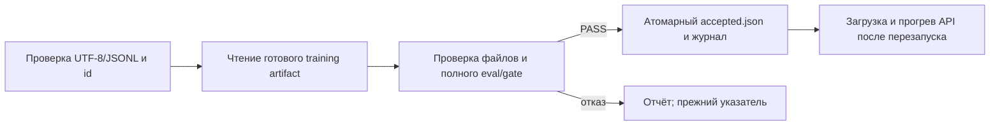

# ДЗ 8+9+10: проверяемый выпуск и реальный API

**Кандидат не принимается: accuracy 62% → 58%,
format rate 100% → 96%. API обслуживает закреплённую baseline.**
Семь дефектов исправлены; локальные проверки, Prefect, реальная оценка,
API, повторная загрузка и нагрузочные опыты выполнены. Нового обучения нет.

## 1. Репозиторий и расследование

Продолжение итогового репозитория ДЗ 1–7 в `mlops_hw/hw8910`.
Исходный прототип — commit `732ddae`; исправленный код — commit `64ac195e8e6259f9e88d6d912fbcbc861bf41733`
([defects.csv](../defects.csv)). История предыдущих работ сохранена.
Старые каталоги решений и тесты `hw67/tests/`, `hw8910/tests/` не редактировались.

Устройство: Mac15,7, arm64, 36 GiB RAM,
macOS 26.3.1, MPS. Python 3.12.14, uv 0.12.10.
Зависимости закреплены в pyproject/uv.lock: Prefect 3.6.21,
FastAPI 0.121.3, Uvicorn 0.38.0,
Torch 2.14.0, Transformers 5.17.0,
PEFT 0.21.0, MLflow 2.22.2.

Каждая из семи независимых причин связана со своим тестом в CSV.
`reproduce_before.py` извлекает **настоящий исходный код из Git**:
семь новых интеграционных тестов падают на поведении, а не на импортах/CLI.
Три теста используют живой HTTP, четыре — процессы/файлы.
В составе этих опытов есть отказ, чужой отчёт, ошибка диска, восстановление,
инвалидация, повтор выпуска и управляемый A → B → A.

[Красный журнал](logs/integration-before.log),
[зелёный stdlib](logs/integration-after.log),
[зелёный FastAPI](logs/fastapi-after.log),
[единый локальный CI](logs/check-after.log).
В новом каталоге также пять проверок транзакции/порчи артефакта.
`make check`: 13 + 12 + 7 + 19 = **51 проверка**, все прошли.
Последние 19 — неизменённые тесты оценки ДЗ 6+7.
Дубликат семи HTTP/process-проверок намеренный: проверяются два транспорта.

## 2. Что переиспользовано из ДЗ 6+7

Training run: `6a15be9f1c564c4d9577513b2011b824`; выбор `all-r8-high`,
версия `models:/amasum-qwen-adapter/1`. Версия реестра сверена с run ID;
адаптер скачан из сохранённого MLflow. Это чтение результата, не обучение.
Старый evaluation run и отказ доступны в `hw67/docs/conclusion.md` и evidence.zip.
Повторён **только eval**, чтобы закрепить полный runtime и использовать
один backend для оценки и API.

Новый реальный [evaluation run](http://127.0.0.1:5006/#/experiments/3/runs/257e77926be24cfaaed346414aeaebcc):
`257e77926be24cfaaed346414aeaebcc`. Адрес localhost доступен на машине автора.
50 golden, 3 behavioral, полный train-index 3185 строк; scorer и quality_gate
из ДЗ 6+7 импортируются без изменений. Оба новых набора raw-ответов сохранены.

| Срез | n | baseline / candidate correct | accuracy baseline / candidate |
|---|---:|---:|---:|
| contradicted_claims | 17 | 0 / 0 | 0.0% / 0.0% |
| supported_claims | 17 | 15 / 15 | 88.2% / 88.2% |
| unstated_claims | 16 | 16 / 14 | 100.0% / 87.5% |

Baseline дала 31/50 верных, 50/50 валидных; кандидат — 29/50 и 48/50.
Ошибок генерации нет. Все три behavioral проходят у обеих версий.
Причина отказа: `Overall accuracy regression`. Две новые ошибки — нарушение JSON-формата,
а не улучшение/ухудшение смысла метки; подробные пары разобраны в прошлом отчёте.
Нулевое качество обеих версий на contradicted_claims остаётся ограничением.

## 3. Prefect-flow, кеш и повторы

Четыре отдельные задачи передают только дескрипторы: URI, model/run ID,
хеши, число строк и конфиг. Веса/тензоры не являются результатами задач.
Реальная подготовка валидирует golden JSONL, а не имитирует обучение.
Ключ — SHA256 канонического JSON `{data_sha256, config}`; config содержит
ревизию токенизатора, template_sha256, max_length, версию кода и формат.
Канонизация: UTF-8, sort_keys, compact separators, ensure_ascii=False, allow_nan=False.
Название файла и mtime не входят. Изменение любого config-поля меняет ключ.

Результат подготовки сохраняется на диске и в Prefect result storage.
В новом процессе после сбоя задача получает `Cached`. Изменённые входные байты
по тому же пути дают `Completed`. Отдельные попытки имеют новые flow/attempt ID;
одинаковый подготовленный результат сохраняет content ID.
Artifact/gate/publish — `NO_CACHE`, retries=0: каждый выпуск проверяется заново.
В локальном потоке нет сетевой задачи; схема/несовместимость/качество не ретраятся.

[Автоматический опыт](../scripts/check_flow.py) использует свежие workspace,
проверяет ожидаемые exit codes и сохраняет run ID в логах. Выполнено 12 команд:

| Опыт | Exit code | Журнал |
|---|---:|---|
| flow-init | 0 | [flow-init.log](../docs/logs/flow-init.log) |
| flow-failure | 1 | [flow-failure.log](../docs/logs/flow-failure.log) |
| flow-recovery | 0 | [flow-recovery.log](../docs/logs/flow-recovery.log) |
| flow-invalidation | 0 | [flow-invalidation.log](../docs/logs/flow-invalidation.log) |
| flow-negative-init | 0 | [flow-negative-init.log](../docs/logs/flow-negative-init.log) |
| flow-negative-report-incomplete | 1 | [flow-negative-report-incomplete.log](../docs/logs/flow-negative-report-incomplete.log) |
| flow-negative-report-A | 1 | [flow-negative-report-A.log](../docs/logs/flow-negative-report-A.log) |
| flow-negative-report-reject | 1 | [flow-negative-report-reject.log](../docs/logs/flow-negative-report-reject.log) |
| flow-crash-init | 0 | [flow-crash-init.log](../docs/logs/flow-crash-init.log) |
| flow-crash | 1 | [flow-crash.log](../docs/logs/flow-crash.log) |
| flow-journal-recovery | 0 | [flow-journal-recovery.log](../docs/logs/flow-journal-recovery.log) |
| flow-repeat | 0 | [flow-repeat.log](../docs/logs/flow-repeat.log) |

## 4. Безопасная публикация и gate

`validate_release` требует complete, настоящий boolean True, eval run ID,
совпадение model ID и четырёх хешей, непустой runtime с пересчётом хеша,
конечные accuracy/format_rate в [0,1] без bool/строк. Полный gate сохраняет
проверки общей accuracy/format rate, критических срезов и behavioral.
`gate_bridge` перепроверяет source SHA, все raw-ответы, counts, id,
наборы данных, runtime и точный код генератора/оценки.
Ручной passed=true не создаёт связанный release-report.

В обоих manifests перечислены реальные файлы; перед публикацией и загрузкой
пересчитываются их SHA256, затем хеш канонического словаря «путь → SHA256».
Для кандидата список включает базу, tokenizer/template и adapter_config/weights.
Незаписанные в списке дополнительные файлы реального пакета тоже запрещены.

Runtime baseline и кандидата одинаков: base revision
`c1899de289a04d12100db370d81485cdf75e47ca`, MPS/bfloat16, system-инструкция,
greedy/do_sample=false, seed 42, max_new_tokens=32, enable_thinking=false,
2048 входных токенов. Точные tokenizer/template hash и generation находятся
в [protocol.json](../metrics/protocol.json).
Runtime SHA256: `08f2dadf6f60ee3714ccd10df8421bef6d64638deb9e8a074a4604f4cc6bb02d`.
Model SHA256 baseline: `a6ecba9a6880debf27b955b25079fbccb55fa84b1445868f5fca542f5f121eb8`.
Protocol SHA256: `4ee0e5d2577e1ef43e876805ea6ff4b72e34faee963c658a6e6d2a6199398edb`.
Golden SHA256: `275adcab6205e8c0f6e30017bf2fca30da9d3f97cb51918707884a704046ecb4`.

Новый локальный указатель сначала инициализируется закреплённой baseline:
полный gate сравнивает baseline с ней же и проверяет completeness/behavioral.
Это **сохранение baseline, не допуск отклонённого адаптера и не абсолютная
гарантия высокого качества**. Реальный кандидат затем получает отказ (exit 1).
SHA256 accepted.json до и после отказа одинаков:
`5b35d26b32e6024f8131785209858e033539afba0c52a4aa07b805af6e9cb404`.
Привязанные [report-baseline](../metrics/release-report-baseline.json),
[report-candidate](../metrics/release-report-candidate.json) и
[опыт публикации](../metrics/real-publication.json) сохранены.

Atomic write: временный файл рядом → flush/fsync → os.replace → fsync каталога.
Отказ gate и ошибка замены сохраняют старые байты; исключение не скрывается,
временный файл удаляется. Ошибка диска внесена mock, настоящий диск не заполнялся.
Перед заменой записывается pending-intent. После неё журнал событий целиком
заменяется атомарно и дедуплицируется по SHA256 `{manifest, report}`.
При сбое между указателем и журналом повтор сначала завершает pending-intent.
После сбоя, восстановления и ещё одного процесса в журнале **одно событие**.
Попытки логируются отдельно; один model_id без runtime/eval не идентифицирует выпуск.
Гарантия рассчитана на одного писателя; alias MLflow champion не изменяется.

Фикстурный PASS помечен synthetic и использует файлы STUB ONLY.
Он доказывает контракты процесса, а не качество модели. Реальный flow требует
отдельного release-report с raw/eval и хешами; API не обслуживает real manifest
через StubBackend.

## 5. Проверки и автоматизация

`make check` прошёл. Намеренная поломка `cache_key` в временной копии дала
Python exit 1, make exit 2; [журнал](logs/check-intentional-failure.log).
Рабочий код при этом не изменялся. Приложенные тесты не ослаблены.
CI выполнен локально. GitHub workflow только приведён как шаблон,
обязательный удалённый check/защита merge не заявляются.

| Событие | Команды и действие |
|---|---|
| Изменился код | `make check`; меняется генерация/scorer → `make evaluate`, повтор gate. Документация не требует обучения |
| Изменились данные | `make check-flow`; ключ инвалидируется по байтам. Eval-набор → новая оценка; train → объяснить и выполнить отдельное обучение, если нужны новые веса |
| Новый адаптер | `scripts/fetch_artifacts.py`, `make evaluate`, `make candidate`; загрузка/полный gate обязательны до смены указателя |

## 6. Реальный API, версия и неверный запрос

FastAPI использует lifespan; загрузка/прогрев идут в фоне.
Health означает жизнь процесса, ready становится 200 только после проверки
файлов, полного допуска, загрузки весов и **настоящей warmup-генерации**.
Зафиксированы health=200/ready=503 до готовности, затем ready=200.
Во время прогрева корректная generate получает 503 без вызова backend.

[Реальный ответ](../metrics/api-smoke.json): HTTP 200,
`{   "answer": "SUPPORTED" }`;
model_id `Qwen/Qwen3-0.6B@c1899de289a04d12100db370d81485cdf75e47ca`,
request_id `db2ab05d-5ef5-4603-bf52-caeeb4aa3863`,
output_tokens=11, generation_seconds=0.304477.
Ответ также содержит runtime_sha256, queue_seconds и total_seconds.
Метаданные берутся из загруженного backend, не перечитываются из указателя.

Неверные запросы (пустой prompt, 0, 100000, строковый лимит, превышение
входных токенов) дают 400 до генерации: backend.calls остаётся 1 → 1;
первый вызов — warmup. Ограничены размер тела, символы/токены и лимит ответа.
У реальной модели разрешён только оценённый лимит 32; stub упражняет диапазон 1..32.
Один lock ограничивает вычисление до одного backend-вызова, ожидание — до 120 с.

STUB-опыт A → B → A выполнен в живых HTTP/process-тестах: после публикации B
работающий API отвечает A до рестарта, затем B; повторный выпуск ранее принятой
A и рестарт возвращают A. Вторая реальная модель не выдаётся за допущенную:
кандидат отклонён. Для реальной baseline выполнен отдельный повторный запуск
API; [restart smoke](../metrics/api-smoke-restart.json) подтверждает тот же ID/runtime.
Во время измерений `/debug` включался явно; обычный real API его не публикует.

## 7. Нагрузка: одинаковые 8 запросов при concurrency 1 и 2

После прогрева использованы первые 8 golden prompts в одинаковом порядке,
одинаковый лимит 32, одна принятая версия; фактическое число токенов есть
в каждой строке. Все 16 попыток сохранены, включая поля ошибки/HTTP status:
[load-attempts.jsonl](../metrics/load-attempts.jsonl),
[CSV](../metrics/load-summary.csv), [JSON](../metrics/load-summary.json).

| concurrency | n | успех / ошибка | пакет, с | успех req/s | средняя клиентская, с | max, с | generation mean, с | queue mean, с |
|---|---:|---:|---:|---:|---:|---:|---:|---:|
| 1 | 8 | 8 / 0 | 2.543 | 3.146 | 0.318 | 0.349 | 0.316 | 0.001 |
| 2 | 8 | 8 / 0 | 2.550 | 3.137 | 0.594 | 0.654 | 0.318 | 0.275 |

При двух клиентах throughput почти не меняется, а клиентская задержка растёт:
второй запрос ожидает lock; генерация остаётся последовательной. Queue time
включает предварительную проверку и ожидание, generation time — вызов backend
с токенизацией/генерацией/декодированием, клиентское время ещё включает HTTP.

## 8. Ограничения и сдача

Восемь запросов на режим и короткий прогон не дают устойчивого p95 или
оценки длительной нагрузки/перегрузки. Все измерения относятся к одной
машине и последовательному Transformers; vLLM/SGLang не запускались.
Одинаковые prompts между режимами необходимы для сравнения, но это не
репрезентативный production-трафик. TTFT/ITL не измерены: ответ возвращается
одним JSON, измерена полная задержка.
Prefill обрабатывает вход целиком, decode последовательно добавляет токены.
KV-cache хранит ключи/значения внимания и растёт с контекстом, слоями,
размерностью и числом активных запросов; параллельный высокопроизводительный
serving с continuous batching здесь не реализован.

Golden небольшой, выбран неслучайно и переиспользуется; независимый аудит
качества и человеческая проверка всех меток не заявляются. Нет абсолютного
порога по провальному contradicted-срезу. Настройка новых порогов требует
нового заранее зафиксированного протокола, а не правки ради PASS.
В server log при завершении Torch-процесса есть предупреждение resource_tracker
о semaphore; успешность HTTP-запросов от этого не подменялась, лог сохранён.

Архив `hw8910-submission.zip` содержит код/историю и малые доказательства,
не содержит весов/окружений/кешей/volumes/секретов. Восстановление —
[access.md](access.md). [Видеодемонстрация и её формат](video.md).

Официальные интерфейсы сверены по документации:
[Prefect tasks](https://reference.prefect.io/prefect/tasks/),
[FastAPI lifespan](https://fastapi.tiangolo.com/advanced/events/).
